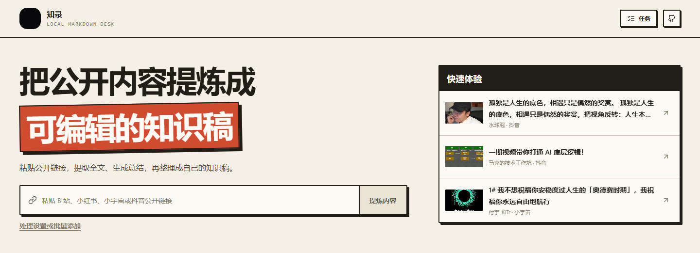
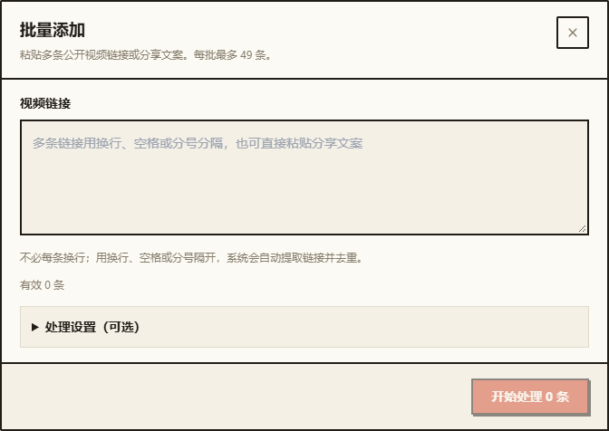
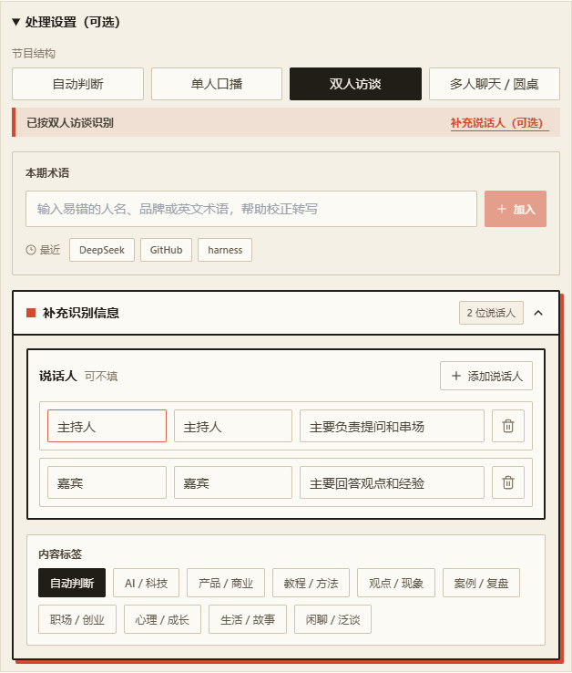
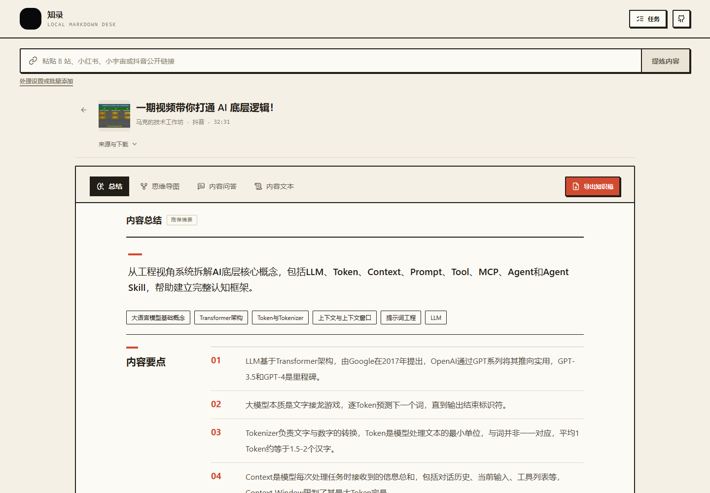
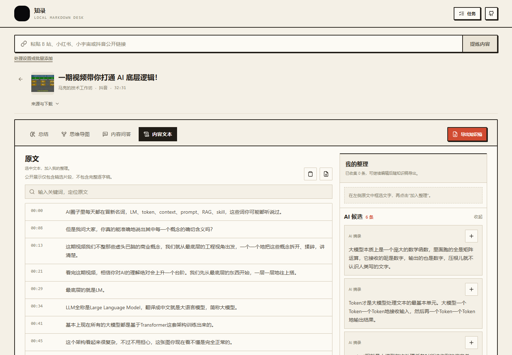
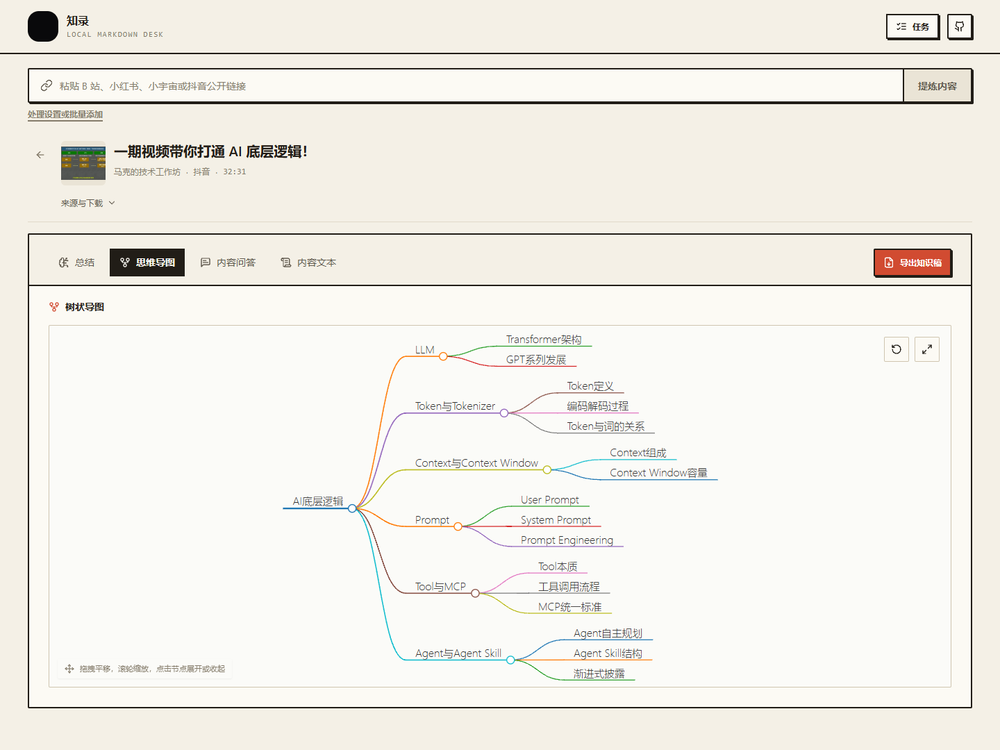

<p align="center">
  
</p>

<p align="center">
  
  
  
  
</p>

**知录**是一款开源的视频与播客知识提炼工具。粘贴链接，先用本地模型把音视频转成可处理的文字，再用你配置的 AI 理解长内容、拆解创作者观点，最终沉淀成适配 Obsidian 的本地 Markdown 知识库。



> 以下截图直接来自本机运行的当前版本。工作台展示应用自带的公开推荐内容；截图更新于 2026-10-12。

[快速启动](#三步启动) · [工作台预览](#真实产品长什么样) · [安装与配置](./docs/README.md) · [公开知识稿示例](./docs/examples/knowledge-draft.md)

## 你可以用它做什么

<p align="center">
  
</p>

- **快速理解长内容**：不必完整看完视频或听完播客，先拿到结构、观点和结论。
- **做竞品拆解与内容研究**：分析创作者的选题、内容结构、论据与表达方式，为自己的创作提供研究材料。
- **沉淀个人知识库**：把分散在平台里的内容整理成可搜索、可编辑、可长期保存的本地笔记。

## 从链接到知识稿

<p align="center">
  
</p>

点击“提炼内容”后，知录会在后台按需解析、下载、本地转写、AI 校对并生成总结。你可以继续提交下一条链接，也可以打开已有知识稿阅读；后台任务完成时不会打断正在查看的内容。刷新页面后可以恢复任务进度，后端需保持运行。

### 多条链接，一起处理

打开输入框下方的“处理设置或批量添加”，直接粘贴链接或平台分享文案。系统自动提取链接、去重，每批最多 **49 条**；节目结构、说话人与校对术语放在可展开的“处理设置”里。

<p align="center">
  
</p>

在任务页查看各条进度、筛选未完成或失败任务、单独取消或重试，并打开已经完成的结果。转写任务按本机资源排队执行。

## 本地转写，固定使用 SenseVoiceSmall

平台字幕可用时直接复用；没有完整文字的音视频，需要本地转写后才能继续总结与问答。首次使用前，建议先运行：

```powershell
.\准备完整本地转写环境.bat
```

脚本会先展示下载计划并等待确认，再根据电脑配置安装依赖，缓存 SenseVoiceSmall 与 FSMN-VAD。后端依赖与模型合计的粗略规划范围为：CPU 下载约 **1.5～3.5 GB**、预留 **4～7 GB**；NVIDIA 下载约 **3～6 GB**、预留 **8～12 GB**。这些不是实测总量，上游版本和已有缓存会影响实际体积。

### 不只是“把声音变成字”

本地识别固定使用 SenseVoiceSmall，无需选择语音模型。需要时可指定单人口播、双人访谈或多人聊天，并从术语库选择容易识别错误的人名、品牌和英文术语，交给 AI 做后续校对。

<p align="center">
  
</p>

访谈和播客可以继续填写说话人姓名、角色或立场，并选择内容标签。它们不会替你编造内容，只用于帮助转写后的校对、说话人整理和结构化分析。

SenseVoiceSmall 在本机识别中文长视频、播客和多人对谈，优先使用 CUDA，也支持同一模型在 CPU 上运行。系统不切换到其他语音模型。

## Markdown 原生，适配 Obsidian

<p align="center">
  
</p>

导出的知识稿是普通 `.md` 文件，可以下载，也可以直接写入你选择的 Obsidian Vault：

- 用 **YAML Properties** 保存平台、作者、来源、关键词和处理日期；
- 用层级标题和原生 **Callout** 保留内容结构与重点摘录；
- 进入 Vault 后即可全文检索，并可继续添加 `[[双链]]`，把一条内容接进自己的知识网络；
- 即使以后不再使用知录或 Obsidian，文件仍能在其他 Markdown 编辑器中继续维护。

> [!NOTE]
> 当前导出不会自动生成双链；知录负责生成结构化 Markdown，双链关系由你在 Obsidian 中继续建立。

## 一份内容，继续整理

<p align="center">
  
</p>

不只生成一份总结。关键观点有可靠关联时可以就地查看当前转写稿中的原文依据，再把观点带入内容问答追问适用条件；也可以展开思维导图，或从原文与 AI 候选中把真正有用的内容加入“我的整理”。

## 真实产品长什么样

工作台把大封面与媒体保存入口收进“来源与下载”，正文区域留给阅读。总结和问答集中展示，原文与导图使用更宽的画布；导出入口在四个内容视图中都可使用。



<details>
  <summary><strong>展开查看原文、我的整理与思维导图</strong></summary>
  <br>

  总结优先给出一句话结论、关键观点、理由、方法与适用条件；内容脉络、案例和辅助分析只在有新增信息时出现。有关联的观点可查看原文依据，但关联不代表外部事实已经核实。

  ### 原文与我的整理

  

  原文统一展示当前有效稿，支持搜索、复制全文与导出文本。AI 候选不会自动进入知识稿；你可以边读边把重点加入“我的整理”，继续编辑，再导出最新内容。

  ### 交互式思维导图

  

  导图支持缩放、平移、重置、全屏、节点高亮与子树展开收起；不完整文本会明确标注内容边界。
</details>

## 核心能力

| 能力 | 当前实现 |
|---|---|
| 多平台链接解析 | B 站、小红书、抖音、小宇宙，以及其他 yt-dlp 可识别来源的实验支持 |
| 内容整理 | 从链接生成结构化总结，并保留来源信息 |
| 后台与批量任务 | 连续提交单条、每批 1～49 条链接、进度恢复、取消、重试与结果回看 |
| 本地模型转写 | 固定使用 SenseVoiceSmall，支持 CUDA 与 CPU |
| AI 校对术语库 | 转写前选择人名、品牌、缩写和专业术语；只影响 AI 校对，不污染原始识别稿 |
| 结构化工作台 | 总结、观点原文核对、就地追问、交互导图、时间轴原文与我的整理 |
| 本地知识归档 | SQLite 本地历史、普通 Markdown 下载、Obsidian Vault 写入 |
| 辅助媒体保存 | 在“来源与下载”中提供原视频下载；部分格式由 ffmpeg 合并音视频 |

## 三步启动

**1. 准备环境**：Windows 10 / 11、Python 3.10+、Node.js 20+ 和 Git。

**2. 获取代码并启动**：

```powershell
git clone https://github.com/Enzo19150326743/zhilu.git
cd zhilu
.\启动网站.bat
```

也可以下载源码 ZIP，解压后双击 `启动网站.bat`。

**3. 配置 AI**：首次双击 `启动网站.bat` 且本机还没有 `backend/.env` 时，会自动弹出一个 Windows 配置窗口；它不是网页弹窗。

> [!IMPORTANT]
> **真实的 AI 总结、内容问答与 AI 校对需要你自己的 API Key。** 在首次弹出的本机窗口里选择服务商并填写 Key；保存后自动写入 `backend/.env`，不会进入网页前端，也不会提交到 Git。

<p align="center">
  
</p>

如果暂时跳过，链接解析、本地历史、已安装模型的本地语音识别和 Markdown 导出仍可使用；总结与问答使用基础降级结果，转写稿保留原始识别文本。首次启动后，这个窗口不会反复自动出现；需要修改时双击 `配置 AI.bat` 重新打开。

配置完成后，启动器会创建项目虚拟环境、安装前后端依赖，并打开 `http://localhost:3000`。

> [!NOTE]
> 这不是只运行 `npm install` 的纯前端项目。根目录启动器会同时管理 FastAPI 后端和 Next.js 前端；纯静态托管无法运行本地 ASR、历史库或 Obsidian 写入。

完整的安装、手动启动与 GPU 可选加速步骤见 [安装指南](./docs/installation.md)。

## 支持范围

| 来源 | 当前支持 | 边界 |
|---|---|---|
| B 站公开视频 | 内容整理、平台字幕、本地转写、辅助下载 | 清晰度取决于平台公开结果与账号权限 |
| 小红书公开视频 | 元数据、作者、封面、本地转写、辅助下载 | 当前只承诺公开的视频笔记页面 |
| 抖音公开视频 | 元数据、实验解析、AI 转写、辅助下载 | 平台页面变化可能影响解析稳定性 |
| 小宇宙公开单集 | 内容整理、本地语音识别 | 当前只承诺公开单集链接 |
| 其他 yt-dlp 来源 | 实验支持 | 不承诺所有站点长期可用 |

当前支持手动添加 1～49 条公开链接批量处理，但不包含频道／整档自动采集、浏览器插件、跨媒体全文检索、向量 RAG、付费或受限内容处理。

> [!IMPORTANT]
> 知录只处理你有权访问和分析的公开内容，不支持 DRM、付费、私密或受限媒体，也不提供绕过平台限制的能力。

本地优先不等于完全离线：解析媒体需要访问来源平台，启用 AI 总结、问答和校对后会向你配置的服务商发送相关文本。详见 [安全说明](./SECURITY.md)。

更多使用说明见 [文档导航](./docs/README.md)，包括安装、配置、Obsidian 导出和常见问题。

发布前可运行本地敏感信息检查：

```powershell
powershell.exe -NoProfile -ExecutionPolicy Bypass -File .\scripts\check-public-release.ps1
```

## 开发

```powershell
# 后端
cd backend
python -m venv .venv
.\.venv\Scripts\python.exe -m pip install -r requirements-dev.txt
.\.venv\Scripts\python.exe -m uvicorn app.main:app --reload --host 127.0.0.1 --port 8000

# 前端（另开终端）
cd frontend
npm ci
npm run dev
```

最相关的本地检查：

```powershell
backend\.venv\Scripts\python.exe -m unittest discover -s backend\tests -v
cd frontend
npm run test:helpers
npm run build
```

当前目标与功能边界见 [产品说明](./docs/product.md)，项目入口见 [代码地图](./docs/code-map.md)，贡献方式见 [CONTRIBUTING.md](./CONTRIBUTING.md)。

```text
frontend/       页面、组件、状态与浏览器测试
backend/        API、媒体适配、本地转写、任务与存储
assets/readme/  README 插图与当前版本截图
docs/           使用指南、架构、示例与研究资料
scripts/        启动、配置、模型准备与发布检查
.local/         本机工具、凭据与浏览器资料（不进入 Git）
evaluation/     本地历史评测证据（不进入 Git）
output/         调试输出（不进入 Git）
```

截图素材与复现方式见 [README 素材说明](./assets/readme/README.md)。

---

<p align="center">
  <a href="./LICENSE">MIT License</a> ·
  <a href="./CREDITS.md">致谢与来源</a> ·
  <a href="./SECURITY.md">安全说明</a> ·
  <a href="./CONTRIBUTING.md">参与贡献</a>
</p>
