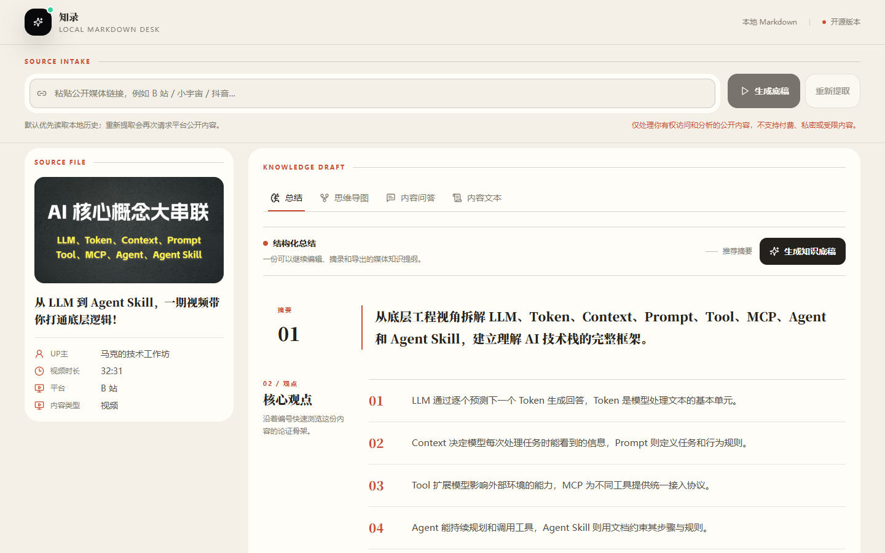
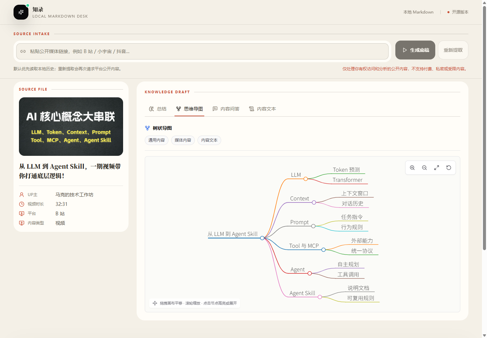
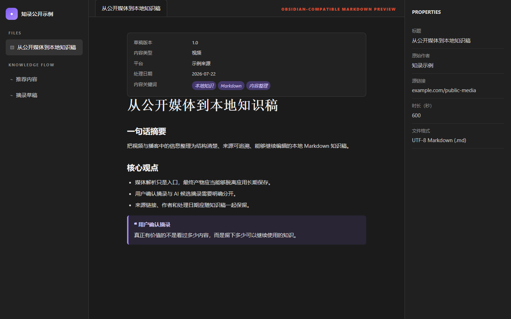

<p align="center">
  
</p>

<h1 align="center">知录</h1>

<p align="center"><strong>看见的，听见的，都沉淀为本地知识。</strong></p>

<p align="center">
  将公开视频与播客转写、总结并整理为保存在本地、可继续编辑的 Markdown 知识稿。
</p>

<p align="center">
  
  
  
  
</p>


知录把散落在视频和播客里的内容，变成你真正能带走的知识资产。粘贴公开链接后，它会优先读取平台字幕或 Shownotes；没有现成文本时，本地已安装 SenseVoiceSmall 会优先用于中文长内容，Whisper 作为英文术语和数字密集内容的备选，也可以手动选择 Fun-ASR-Flash 云端快速识别。随后继续整理摘要、导图、问答和摘录，最终导出普通 `.md` 文件。

> [!IMPORTANT]
> 知录只处理你有权访问和分析的公开内容，不支持 DRM、付费、私密或受限媒体，也不提供绕过平台限制的能力。

## 能做什么

| 能力 | 得到什么 |
|---|---|
| 多媒体文本获取 | 从 B 站、小红书、抖音、小宇宙等公开来源取得字幕、Shownotes 或媒体信息 |
| 多路径 AI 转写 | 中文长内容默认推荐 SenseVoiceSmall，英文术语和数字密集内容可改用 Whisper，云端识别保持手动选择 |
| AI 校对热词与术语库 | 转写前批量选择本期热词，识别完成后注入 AI 校对；支持文件夹、最近使用和常用术语管理 |
| 结构化理解 | 根据课程、访谈、观点视频或播客组织摘要，并生成可缩放、平移和高亮的树状导图 |
| 内容问答 | 围绕当前媒体文本继续追问，不脱离来源凭空扩写 |
| 摘录工作流 | 区分用户确认摘录与 AI 未确认候选，保留可靠原文 |
| Markdown 沉淀 | 下载 `.md`，或选择直接写入本地 Obsidian Vault |



## 从链接到知识稿

```text
公开媒体链接
    ↓
平台字幕 / Shownotes / 本地或云端 AI 转写
    ↓
摘要 / 导图 / 问答 / 摘录
    ↓
本地历史 + Markdown / Obsidian 知识稿
```

1. 粘贴公开媒体链接并生成底稿。
2. 检查文本来源；缺少字幕时优先用 SenseVoiceSmall 转写中文长内容，也可按内容切换模型。
3. 整理总结、导图和摘录，然后导出 Markdown。

## 本地转写怎么选

| 模型 | 推荐场景 | 运行方式 | 需要注意 |
|---|---|---|---|
| **SenseVoiceSmall（默认推荐）** | 中文长视频、中文播客、多人对谈 | 本地免费；优先 CUDA，失败时可回退 CPU | 英文术语、连续数字和代码名称仍建议结合原媒体复核 |
| **Whisper large-v3-turbo** | 英文较多、数字密集、技术术语较多的内容 | 本地免费；支持 CUDA 和 CPU | 在当前本地配置下通常比 SenseVoiceSmall 慢 |
| **Fun-ASR-Flash** | 已配置阿里云密钥、希望手动尝试云端快速识别 | 云端按量计费 | 只有用户明确选择后才上传音频片段，不会静默回退本地模型 |

每次转写只运行你选中的一个模型，不会为了“交叉验证”自动双跑。只有第一次结果不理想时，才需要主动重转写并保留另一份稿件作比较。

SenseVoiceSmall 的短句会在校对前整理成约 4～8 秒的连续片段，减少逐字稿里一两秒一断的阅读跳跃；原始细粒度片段仍完整保留，不牺牲回看与排查能力。

## AI 校对热词与常用术语库

“转写设置”中可以提前填写人名、品牌、英文缩写和专业术语。支持使用逗号、顿号或换行批量输入，也可以从最近使用、常用术语或自建文件夹中选择。

这些热词只在 Whisper、SenseVoiceSmall 或 Fun-ASR 完成原始识别后提供给 AI 校对，用于修正常见同音词、错别字和英文写法，不会污染原始识别稿。每次新转写默认不自动选择历史术语；转写成功后才会更新使用次数和最近使用时间。AI API 不可用或校对失败时仍保留原始稿，并明确提示本期术语没有生效。

## 结构化摘要与交互导图

总结与导图由同一次完整文本分析生成，并根据内容类型调整组织重点，而不是把课程、访谈和观点视频强行套进同一个模板。

- 一个明确的中心主题，通常组织为 4～7 个主要分支。
- 默认展开到第三级，节点尽量使用短语表达观点、依据、案例、条件和结论。
- 支持放大、缩小、适应画布、重置视图和拖拽画布平移。
- 点击节点可以高亮当前主题或展开、收起子树；点击画布可取消高亮。
- 对 Shownotes 等非完整逐字稿，会在导图上明确提示内容边界。



## 支持范围

| 来源 | 当前支持 | 说明 |
|---|---|---|
| B 站公开视频 | 元数据、公开字幕、格式列表、AI 转写、辅助下载 | 清晰度和字幕取决于平台公开结果与账号权限 |
| 小红书公开视频 | 元数据、作者、格式列表、AI 转写 | 目前支持公开的视频笔记页面；无平台字幕时需手动生成 AI 转写稿 |
| 抖音公开视频 | 元数据、实验解析、AI 转写、辅助下载 | 平台页面变化可能影响解析稳定性 |
| 小宇宙公开单集 | 元数据、Shownotes、本地 ASR | Shownotes 不等于完整逐字稿 |
| 其他 yt-dlp 可识别来源 | 实验支持 | 不承诺所有站点长期可用 |

当前不包含整档批量导入、浏览器插件、跨媒体全文检索和向量 RAG。

## Windows 快速开始

### 环境准备

- Windows 10 / 11
- Python 3.10+
- Node.js 20+
- Git（也可以直接下载仓库 ZIP）
- ffmpeg（仅在合并音视频或部分转写场景需要）

### 三步启动

```powershell
git clone https://github.com/Enzo19150326743/zhilu.git
cd zhilu
.\启动网站.bat
```

也可以下载源码 ZIP、解压后双击 `启动网站.bat`。

首次运行会自动创建 Python 虚拟环境、安装前后端依赖、询问是否配置自己的 AI API，然后打开 `http://localhost:3000`。后续仍然双击同一个文件启动。

### 推荐：一次准备完整本地转写环境

如果确定要使用本地转写，建议在第一次启动前双击：

```powershell
.\准备完整本地转写环境.bat
```

脚本会先显示预计下载量并等待确认，然后自动检测 Windows NVIDIA 显卡，安装适合当前电脑的依赖，并提前缓存以下模型：

| 下载内容 | 约计体积 | 用途 |
|---|---:|---|
| [Whisper large-v3-turbo](https://huggingface.co/mobiuslabsgmbh/faster-whisper-large-v3-turbo/tree/main) | 1.62 GB | 英文、数字和技术术语较多的内容 |
| [SenseVoiceSmall](https://huggingface.co/FunAudioLLM/SenseVoiceSmall/tree/main) | 0.94 GB | 中文长视频、播客和多人对谈 |
| FSMN-VAD | 较小 | 为 SenseVoiceSmall 切分长音频 |
| Python / CPU 或 CUDA 依赖 | 随平台和上游版本变化 | 运行两个本地识别引擎 |

完整 CPU 环境预计下载约 **3～5 GB**，建议预留 **6～10 GB**；完整 NVIDIA 环境预计下载约 **6～8 GB**，建议预留 **12～15 GB**。这是包含依赖和两个模型的保守区间，上游版本与缓存状态会让实际数字波动。准备完成后再运行：

```powershell
.\启动网站.bat
```

需要显式指定模式时，可以运行：

```powershell
# 自动检测（推荐）
powershell -ExecutionPolicy Bypass -File .\scripts\prepare-local-asr.ps1 -Mode Auto

# 强制只安装 CPU 环境
powershell -ExecutionPolicy Bypass -File .\scripts\prepare-local-asr.ps1 -Mode Cpu

# 强制安装 Windows NVIDIA / CUDA 环境
powershell -ExecutionPolicy Bypass -File .\scripts\prepare-local-asr.ps1 -Mode Nvidia
```

> [!WARNING]
> Fork 或把前端部署到静态 Web 托管平台，不会把本地模型一起部署。必须在真正运行 FastAPI 后端的 Windows 机器上执行准备脚本；模型缓存、虚拟环境和 CUDA 文件不会提交到 GitHub。纯静态前端部署无法运行本地 ASR。

> [!NOTE]
> 这不是一个只靠 `npm install` 就能运行的纯前端项目。根目录启动器会同时管理 FastAPI 后端和 Next.js 前端；`frontend/npm run dev` 只启动前端。

完整安装、手动启动与 GPU 可选加速见 [安装指南](./docs/installation.md)。

## 使用 Tips

- 第一次建议用 3～10 分钟的公开视频跑通流程。
- 未配置 AI Key 仍能解析内容；总结、问答和校对会使用本地降级结果。
- 没有提前运行完整环境准备脚本时，Whisper 或 SenseVoiceSmall 仍可能在第一次使用时下载对应模型。
- 完整环境准备脚本只修改项目虚拟环境和用户模型缓存，不会安装显卡驱动或修改系统全局 `PATH`。
- 修改 AI、Cookie、ASR 或下载目录后，需要重启后端并点击“重新提取”。
- 云端识别只有在配置阿里云密钥并由用户手动选择后才会上传音频片段；失败时不会静默改用本地模型。
- B 站只返回 480p 不一定是筛选错误，可能是平台本次公开格式上限。
- 小宇宙优先读取公开 Shownotes；需要完整文本时可以手动生成 AI 转写稿。
- 本地下载只是辅助保存能力，请确保你拥有相应内容的访问和处理权限。

## AI 与本地能力

AI 配置是可选的。你可以双击 `配置 AI.bat`，填写自己的 DeepSeek 或其他 OpenAI-compatible 接口；Key 只写入本机 `backend/.env`，不会进入前端。

本地 SenseVoiceSmall 与 Whisper 都不强制要求 NVIDIA 显卡。SenseVoiceSmall 可用时会成为转写弹窗的推荐默认项；未安装时自动使用 Whisper。Windows + NVIDIA 用户可以安装项目内 CUDA 依赖，推理失败时仍保留 CPU 路径，不修改系统全局环境。

配置项和安全边界见 [配置指南](./docs/configuration.md)。常见错误见 [排查指南](./docs/troubleshooting.md)。

## 本地优先与隐私

| 会进入公开仓库 | 只留在你的电脑 |
|---|---|
| 源代码、依赖清单、空白 `.env.example` | API Key、Cookie、浏览器登录态 |
| 原创界面资源、公开安全截图 | `backend/.env`、本地绝对路径 |
| 合成或经审查的推荐内容 | SQLite 历史、下载文件、日志 |
| 测试、使用文档、许可证 | Whisper 模型、CUDA 缓存、Obsidian Vault |

真实历史保存在 `backend/data/local_library.sqlite3`，默认不会进入 Git。发布前可以运行：

```powershell
powershell.exe -NoProfile -ExecutionPolicy Bypass -File .\scripts\check-public-release.ps1
```

该脚本会检查候选公开文件中的敏感值和禁止路径。更多安全报告方式见 [SECURITY.md](./SECURITY.md)。

## 开发与验证

手动开发启动：

```powershell
# 终端 1：后端
cd backend
python -m venv .venv
.\.venv\Scripts\python.exe -m pip install -r requirements.txt
.\.venv\Scripts\python.exe -m uvicorn app.main:app --reload --host 127.0.0.1 --port 8000

# 终端 2：前端
cd frontend
npm ci
npm run dev
```

主要验证命令：

```powershell
backend\.venv\Scripts\python.exe -m unittest discover -s backend\tests -v
cd frontend
npm run test:helpers
npm run build
cd ..
.\scripts\check-public-release.ps1
```

项目结构见 [代码地图](./docs/code-map.md)，贡献方式见 [CONTRIBUTING.md](./CONTRIBUTING.md)。

## 不止是摘要，而是可带走的本地知识稿



知录导出的每份知识稿都是普通 `.md` 文件，不被数据库或某个云服务锁住。文件包含 Obsidian 可识别的 YAML Properties、层级标题、来源链接与原生 Callout 摘录；你可以下载到任意 Vault，也可以选择直接写入本地 Obsidian 目录。

即使未来不再使用知录或 Obsidian，这些知识仍然可以在任何 Markdown 编辑器中继续维护。你可以先查看 [公开合成知识稿](./docs/examples/knowledge-draft.md)，详细字段与兼容边界见 [Obsidian 导出说明](./docs/obsidian-export.md)。

---

[MIT License](./LICENSE) · [致谢与来源](./CREDITS.md) · [安全说明](./SECURITY.md) · [参与贡献](./CONTRIBUTING.md)
